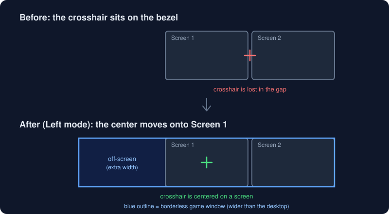

# Viewport Shifter

Move the center of a game (and so the crosshair) off the bezel when you play across two monitors.

If you join two screens into one wide display with NVIDIA Surround, or stretch a borderless game window across an extended desktop, the game draws its center right where the two monitors meet. Viewport Shifter moves that center onto the left or right screen, and you switch between them with a hotkey.

Windows only.



## How it works

A game draws its crosshair at the center of **its own window**. Viewport Shifter makes the game window borderless and places it so that its center lands on the screen you chose. Part of the window then sits off the edge of the desktop.

With two 1920×1080 screens (desktop width 3840):

| Mode | Window | Result |
|------|--------|--------|
| Normal | 3840×1080 at x = 0 | Same as before. Center on the bezel. |
| Left | 5760×1080 at x = −1920 | Center in the middle of the left screen. Both screens fully filled. |
| Right | 5760×1080 at x = 0 | Center in the middle of the right screen. Both screens fully filled. |

In **Full** fit mode the window spans a virtual third screen so both monitors stay covered. That third screen renders off-screen, so about **33% of the rendered pixels are wasted**. **Capped** mode never makes the window wider than the desktop (about 25% waste), but part of the far screen is left uncovered.

Switching between Left and Right only moves the window, so it is instant and the game doesn't rebuild its swapchain.

## Anti-cheat

The program only makes window-manager calls: `SetWindowPos`, `SetWindowLongPtrW`, `RegisterHotKey`, and `OpenProcess` with `PROCESS_QUERY_LIMITED_INFORMATION` to read the exe name. It does **not** inject DLLs, hook the game, or read or write game memory. It does the same kind of thing as window-snapping and borderless-window tools.

This is not a guarantee. Anti-cheat systems are closed, and any of them may flag any tool. Use it at your own risk, and try it first on games without anti-cheat.

## Limitations

- The game must run in **borderless/windowed** mode, not exclusive fullscreen.
- HUD elements pinned to the off-screen part of the window are cut off. A game's HUD safe-zone setting may help.
- Full mode costs roughly 1.5× the GPU load of Normal mode.
- Some games reset their window size or position. The app re-applies the placement every 500 ms, and some games may still fight it. Try Capped mode for those.
- Tested on Windows 11 only.

## Build and run

You need a recent stable Rust toolchain (edition 2024).

```bash
cargo run --release
```

Command-line helpers:

```bash
# print monitors, panels and visible windows
cargo run --release -- --list

# place a window by title (substring), wait for Enter, then restore it
cargo run --release -- --shift "Notepad" left
```

Run the tests with `cargo test`.

## Usage

1. Set your game to borderless/windowed mode.
2. Start Viewport Shifter. Pick the game in the **Game window** list and click **Use**.
3. Click **Left** or **Right**, or use a hotkey. **Restore original** puts the window back.

If no window is selected when you press a hotkey, the foreground window is used.

Default hotkeys:

| Action | Hotkey |
|--------|--------|
| Center on left screen | Ctrl+Alt+← |
| Center on right screen | Ctrl+Alt+→ |
| Normal (whole desktop) | Ctrl+Alt+↓ |
| Restore original window | Ctrl+Alt+End |

### Game profiles

Add a profile (exe name, default side, center position, fit mode) and the app applies it automatically when that game's window appears.

## Configuration

Settings are saved to `%APPDATA%\viewport-shifter\config.toml`. The GUI edits them, and you can edit the file by hand too.

```toml
surround_panels = 2   # how many panels to split one wide (Surround) monitor into
bezel_px = 0          # gap between panels
center_frac = 0.5     # center position inside the chosen screen (0 = left edge, 1 = right edge)
fit = "full"          # "full" or "capped"

[hotkeys]
left = "ctrl+alt+left"
right = "ctrl+alt+right"
normal = "ctrl+alt+down"
restore = "ctrl+alt+end"

[[profiles]]
exe = "game.exe"
default_side = "left"
center_frac = 0.5
fit = "full"
```

Hotkeys use `ctrl`, `alt`, `shift`, `win` plus one key: a letter, a digit, an arrow, `home`, `end` or `F1`–`F12`.

With NVIDIA Surround, Windows sees a single wide monitor, so the app splits it into `surround_panels` panels. With two normal monitors it uses the real layout.

## Project layout

```
src/
  layout.rs    window geometry (pure, unit-tested)
  monitors.rs  monitor enumeration and Surround splitting
  target.rs    finding game windows and exe names
  shifter.rs   apply and restore a window's placement
  worker.rs    background thread: hotkeys, auto-apply, re-apply
  config.rs    settings file and hotkey parsing
  gui.rs       egui interface
  main.rs      entry point and CLI helpers
```

## License

[MIT](LICENSE)
